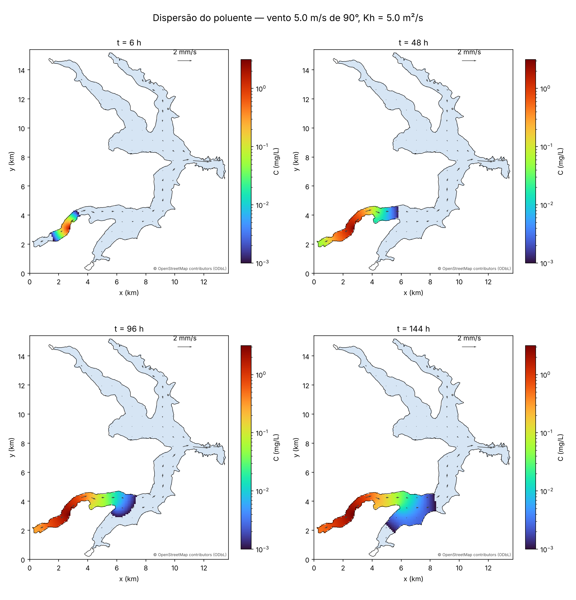

# paranoa_agua_rasa

Simulação 2D da dispersão de um poluente no **Lago Paranoá** (Brasília-DF) usando as
**equações de água rasa** (integradas na vertical), acopladas a uma equação de
advecção-difusão-decaimento para o poluente.



## O que o modelo faz

- **Geometria real**: contorno do lago (com ilhas) obtido do OpenStreetMap
  (relação OSM `2758139`, via API Nominatim). Baixado na 1ª execução e guardado em
  `paranoa_osm.geojson` (já incluído no repositório, para rodar offline).
- **Profundidade constante** (`prof`, padrão 12 m).
- **Hidrodinâmica**: elevação da superfície e correntes médias na vertical, com
  Coriolis, atrito de fundo, vento e viscosidade turbulenta. Grade C de Arakawa,
  esquema explícito *forward-backward*, passo de tempo pelo critério CFL.
- **Poluente**: advecção pela corrente, difusão turbulenta e decaimento de 1ª ordem,
  em volumes finitos (conserva massa, sem concentrações negativas).
- **Afluentes e barragem**: Riacho Fundo, Gama, Bananal e Torto entram nas pontas
  dos braços; a saída é pela barragem, mantendo o nível médio constante.
- **Lançamento**: contínuo (`'continuo'`, ex.: efluente de ETE) ou instantâneo
  (`'derrame'`), por padrão no braço do Riacho Fundo.

## Como rodar

```bash
pip install -r requirements.txt
python3 simulacao_paranoa.py
```

Todos os parâmetros ficam no dicionário `CFG` no início do script. As figuras
(mapa, concentração, séries temporais e GIF) são salvas em `saida_paranoa/`.
Exemplos de saída estão em [`resultados/`](resultados/). A simulação padrão
(6 dias, grade de 100 m) leva alguns minutos.

## Limitações (modelo didático)

- Profundidade constante; o lago real tem batimetria variável.
- Posições de afluentes, barragem, lançamento e pontos de monitoramento são
  **aproximadas** e devem ser conferidas em `01_mapa.png`.
- Vazões, vento, carga e difusividade (`Kh`) são valores **ilustrativos**, não
  calibrados com medições.
- Modelo médio na vertical: não representa estratificação térmica nem correntes
  diferentes entre superfície e fundo.

## Dados

Contorno do lago: © [OpenStreetMap contributors](https://www.openstreetmap.org/copyright),
licença ODbL.
