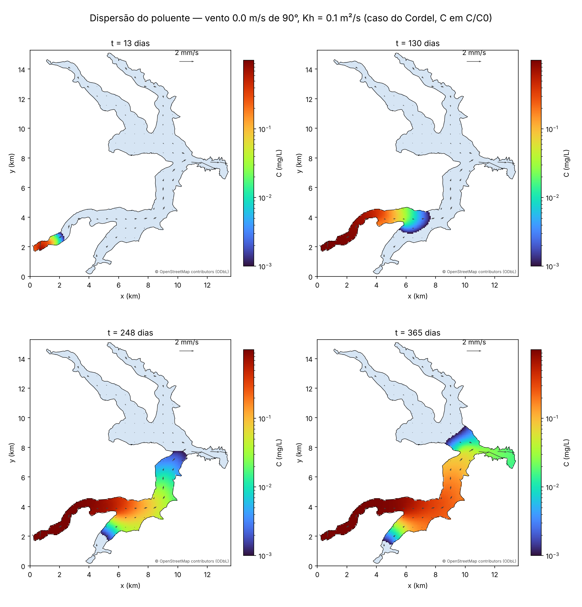
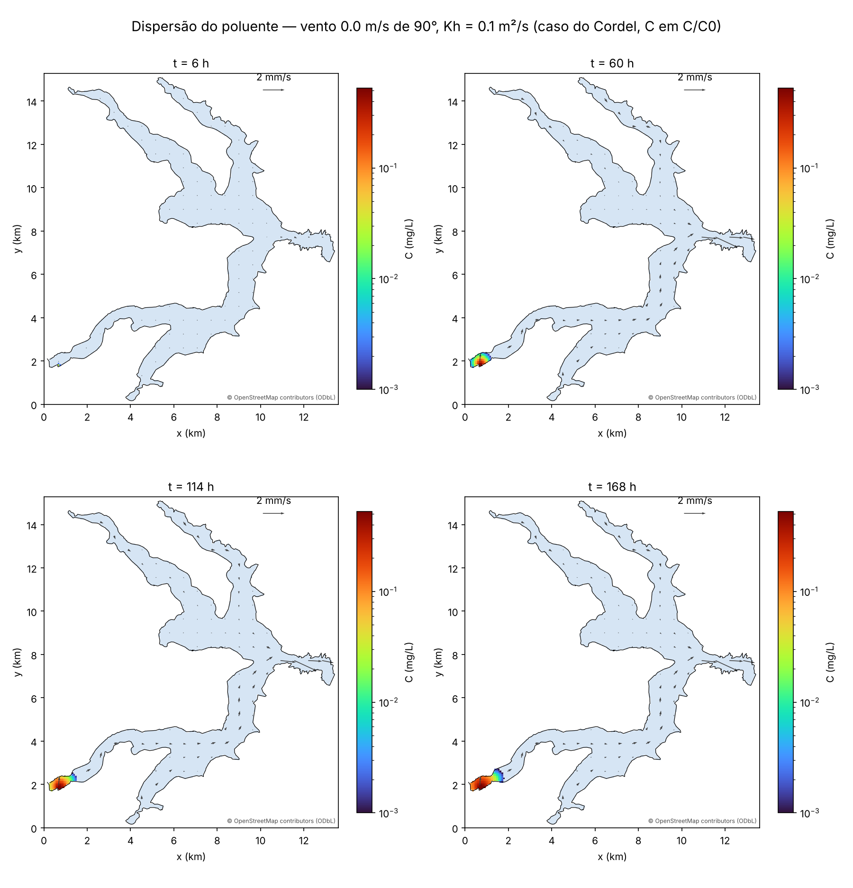

# paranoa_agua_rasa

Simulação 2D da dispersão de um poluente no **Lago Paranoá** (Brasília-DF) usando as
**equações de água rasa** (integradas na vertical), acopladas a uma equação de
advecção-difusão-decaimento para o poluente.


## O que o modelo faz

- **Geometria real**: contorno do lago (com ilhas) obtido do OpenStreetMap
  (relação OSM `2758139`, via API Nominatim). Baixado na 1ª execução e guardado em
  `paranoa_osm.geojson` (já incluído no repositório, para rodar offline).
- **Profundidade constante** (`prof`, padrão 12 m).
- **Hidrodinâmica**: elevação da superfície e correntes médias na vertical, com
  Coriolis, atrito de fundo, vento e viscosidade turbulenta. Grade C de Arakawa,
  esquema explícito *forward-backward*, passo de tempo pelo critério CFL.
- **Poluente**: advecção pela corrente, difusão turbulenta e decaimento de 1ª ordem,
  em volumes finitos (conserva massa, sem concentrações negativas).
- **Afluentes e barragem**: Riacho Fundo, Gama, Bananal e Torto entram nas pontas
  dos braços; a saída é pela barragem, mantendo o nível médio constante.
- **Lançamento**: contínuo (`'continuo'`, ex.: efluente de ETE) ou instantâneo
  (`'derrame'`), por padrão no braço do Riacho Fundo.

## Como rodar

```bash
pip install -r requirements.txt
python3 simulacao_paranoa.py
```

Todos os parâmetros ficam no dicionário `CFG` no início do script. As figuras
(mapa, concentração, séries temporais e GIF) são salvas em `saida_paranoa/`.
Exemplos de saída estão em [`resultados/`](resultados/). A simulação padrão
(6 dias, grade de 100 m) leva alguns minutos.

## Caso do Cordel (comparação entre códigos)

`--caso cordel` roda o caso `paranoa` do [Cordel](https://github.com/lucianonoleto79/cordel)
(`casos/paranoa.py`) com este código, para comparar métodos numéricos: o mesmo contorno
(`paranoa_contorno_cordel.json`, UTM 23S, sem ilhas), os cinco afluentes do Cordel (bananal 1,5;
torto 2,0; riacho fundo 2,5; gama 2,0; cabeça de veado 0,5 m³/s) com rampa de 1 dia, C/C0 = 1 na
água do Riacho Fundo, saída na barragem, ν = Kh = 0,1 m²/s e **sem** vento, Coriolis, atrito de
fundo nem decaimento. Os afluentes entram como fontes de volume numa célula (só advecção: sem a
entrada difusiva que a condição C = 1 imposta na foz produz no Cordel).

```bash
python3 simulacao_paranoa.py --caso cordel --dias 7 --dx 80
```

Com `--dias` acima de 7 os mapas são gravados em 30, 90, 180 e 365 dias (escolha outros com
`--mapas`). 365 dias com `--dx 80` levam ~15 h (12 milhões de passos de 2,6 s). O estado é gravado em
`<pasta>/checkpoint.npz` a cada 30 min de tempo de parede; `--parar-apos HORAS` grava e para
(código 3) depois de HORAS, e `--continuar` retoma do checkpoint com resultado idêntico ao de uma
rodada direta:

```bash
python3 simulacao_paranoa.py --caso cordel --dias 365 --dx 80 --parar-apos 1.75
python3 simulacao_paranoa.py --caso cordel --dias 365 --dx 80 --parar-apos 1.75 --continuar   # repetir até terminar
``` Os comandos para rodar os três códigos por
365 dias estão no relatório de comparação.

**Rodada de 365 dias** ([`resultados/caso_cordel_365d/`](resultados/caso_cordel_365d/)): 12 097 253 passos
em 13,4 h, em 8 trechos de 1h45 (`trecho_01.log` … `trecho_08.log`). C/C0 média de 0,172 no lago,
0,118 no corpo central, 0,022 na barragem e 0 no Braço Norte; 0,46% do poluente saiu pela barragem;
massa conservada a 3×10⁻¹⁰. A comparação com o Cordel e o fvm-cfd está em
[`resultados/comparacao_codigos_365d/`](resultados/comparacao_codigos_365d/) (cópia do relatório do
Cordel), e o enunciado do trabalho de disciplina, em `trabalho/enunciado.pdf` do
[Cordel](https://github.com/lucianonoleto79/cordel/blob/main/trabalho/enunciado.pdf).



Em 7 dias (grade 170 × 191 de 80 m, 5 947 células molhadas): Δt = 2,6 s pelo CFL das
ondas de gravidade, 232 003 passos, 17 min (4,4 ms por passo). A isolinha de C/C0 = 1% chega
a 1,07 km da foz do Riacho Fundo (Cordel e fvm-cfd: 1,11 km); C/C0 = 0,0016 na sonda do
braço; massa do poluente conservada a 4×10⁻¹² (relativo). A superfície quase não se mexe
(|η| < 0,005 cm).

Saída em [`resultados/caso_cordel_7d/`](resultados/caso_cordel_7d/) (figuras, `simulacao.log`;
o `resultados.npz` não é versionado). A comparação com o Cordel e o fvm-cfd, com sugestões de
tópicos para um trabalho de disciplina, está em
[`resultados/comparacao_codigos/`](resultados/comparacao_codigos/) (cópia do relatório do Cordel,
`resultados/comparacao_paranoa/`). **Ilustrativo, não calibrado.**



## Limitações (modelo didático)

- Profundidade constante; o lago real tem batimetria variável.
- Posições de afluentes, barragem, lançamento e pontos de monitoramento são
  **aproximadas** e devem ser conferidas em `01_mapa.png`.
- Vazões, vento, carga e difusividade (`Kh`) são valores **ilustrativos**, não
  calibrados com medições.
- Modelo médio na vertical: não representa estratificação térmica nem correntes
  diferentes entre superfície e fundo.

## Dados

Contorno do lago: © [OpenStreetMap contributors](https://www.openstreetmap.org/copyright),
licença ODbL.
