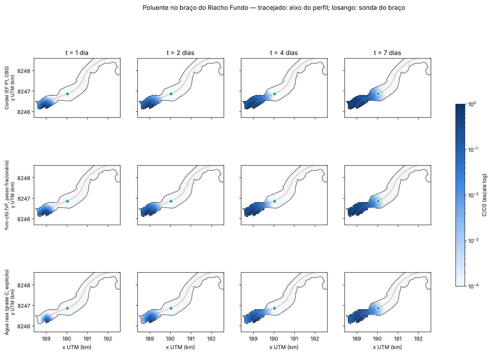
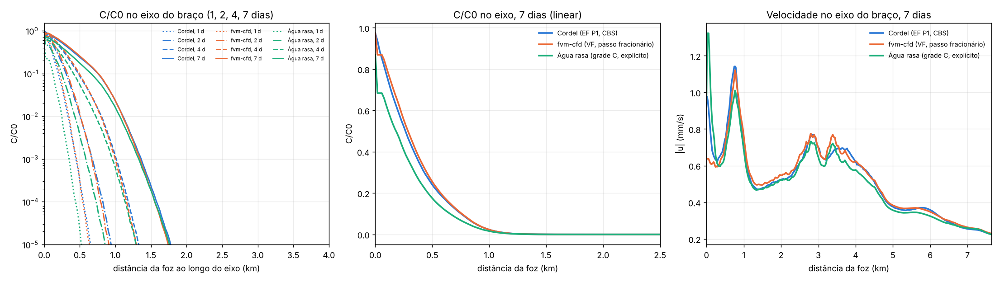
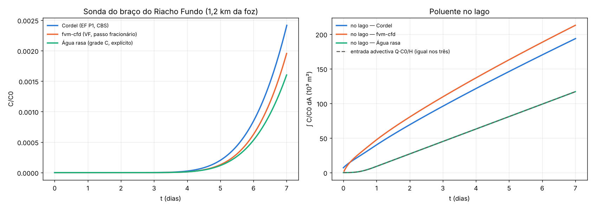
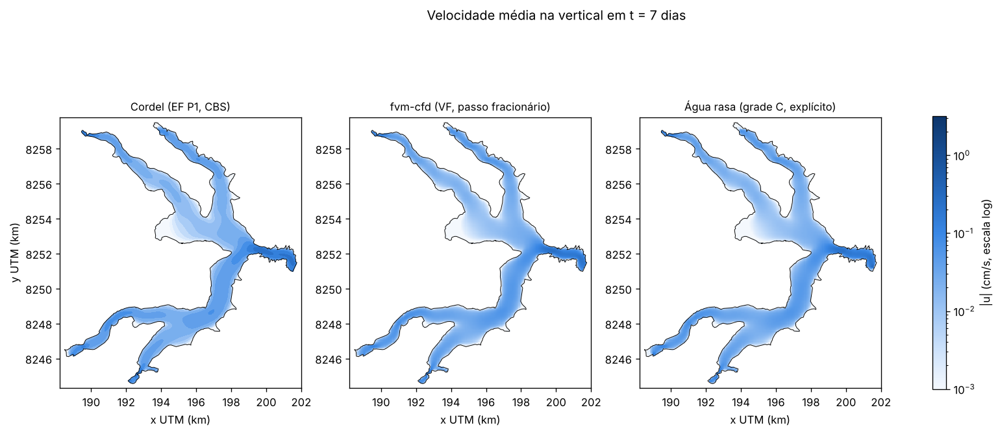
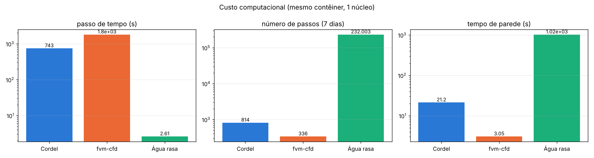

# Lago Paranoá em três códigos de CFD — comparação (1 semana, ilustrativo)

> Cópia do relatório mantido no Cordel (`resultados/comparacao_paranoa/`), onde está o script que gera as figuras.

O caso `paranoa` do Cordel (poluente lançado pelo Riacho Fundo no Lago Paranoá)
resolvido por três códigos com métodos numéricos diferentes, nas mesmas condições,
para um trabalho de disciplina de Mecânica dos Fluidos. **Os parâmetros são
ilustrativos e não calibrados**: vazões, profundidade e coeficientes de mistura são
ordens de grandeza, e o modelo não tem vento, Coriolis, atrito de fundo, batimetria
nem estratificação. Comparar os três códigos mostra diferenças entre **métodos**;
não diz qual está mais perto do lago real, porque não há medição para comparar.

| Código | Repositório | Equações | Discretização |
|---|---|---|---|
| **Cordel** | [`cordel`](https://github.com/lucianonoleto79/cordel) (`casos/paranoa.py`) | Navier–Stokes incompressível 2D + escalar | elementos finitos P1 em triângulos, CBS (Characteristic-Based Split), explícito, massa concentrada |
| **fvm-cfd** | [`fvm-cfd`](https://github.com/lucianonoleto79/fvm-cfd) (`python/paranoa.py`, caso novo) | Navier–Stokes incompressível 2D + escalar | volumes finitos em malha cartesiana desencontrada; convecção AB2, difusão Crank–Nicolson, projeção incremental; escalar explícito com limitador TVD (van Leer) |
| **Água rasa** | [`paranoa_agua_rasa`](https://github.com/lucianonoleto79/paranoa_agua_rasa) (`--caso cordel`) | água rasa (superfície livre η) + escalar | diferenças/volumes finitos na grade C de Arakawa, *forward-backward* explícito; escalar upwind de 1ª ordem |

## O caso (igual nos três)

- Contorno do OpenStreetMap (`casos/dados/paranoa_contorno.json`, UTM 23S, sem ilhas;
  © OpenStreetMap contributors, ODbL), área 38,1 km², profundidade uniforme H = 12 m.
- Cinco afluentes: Bananal 1,5; Torto 2,0; **Riacho Fundo 2,5 (C/C0 = 1)**; Gama 2,0;
  Cabeça de Veado 0,5 m³/s (C/C0 = 0), com rampa de 0 ao valor nominal em 1 dia;
  saída de 8,5 m³/s na barragem.
- ν = κ = 0,1 m²/s (viscosidade e difusividade turbulentas horizontais); margens com
  u = v = 0 e fluxo de poluente nulo.
- Malha de 80 m nos três; **7 dias** simulados; mapas em 1, 2, 4 e 7 dias; sondas nos
  mesmos pontos (os nós escolhidos pelo Cordel).

O que muda de um código para outro, além do método:

| | Cordel | fvm-cfd | Água rasa |
|---|---|---|---|
| margem | triângulos ajustados ao contorno | células em escada (centro dentro do contorno) | idem |
| entrada do poluente | C = 1 imposto nos nós da foz (Dirichlet) | C = 1 imposto nas faces da foz (advecção + difusão pela meia célula) | carga Q·C0 somada a uma célula (só advecção) |
| entrada de água | velocidade normal em 3–4 nós de contorno | velocidade normal em 4–6 faces | fonte de volume em uma célula |
| incompressibilidade | equação de Poisson da pressão | equação de Poisson da pressão | superfície livre: ondas de gravidade com c = √(gH) ≈ 10,8 m/s |

## Resultados em 7 dias



| em t = 7 dias | Cordel | fvm-cfd | Água rasa |
|---|---|---|---|
| alcance da isolinha de 1% no eixo do braço (km) | 1,11 | 1,11 (+0%) | 1,07 (−3%) |
| alcance de 0,1% no eixo (km) | 1,38 | 1,36 | 1,34 |
| área com C/C0 ≥ 1% (km²) | 0,591 | 0,589 | 0,557 |
| C/C0 na sonda do braço (1,2 km da foz) | 0,0024 | 0,0020 | 0,0016 |
| poluente no lago, ∫ C/C0 dA (10³ m²) | 194 | 213 (+10%) | 117 (−40%) |
| C/C0 máximo | 1,000 | 0,973 | 0,869 |
| velocidade no nó da sonda (mm/s) | 0,49 | 0,52 | 0,48 |

(Tabela completa em [`tabelas.md`](tabelas.md); números com mais casas em
[`metricas.json`](metricas.json).)





**1. A forma e o alcance da pluma concordam.** Em 7 dias o poluente só ocupa os
primeiros ~1,5 km do braço do Riacho Fundo (o tempo de residência do lago, V/Q, é de
~620 dias). A isolinha de 1% chega a 1,11 km no Cordel e no fvm-cfd e a 1,07 km na
água rasa; as áreas com C/C0 ≥ 1% diferem menos de 6%. Na sonda do braço, que está na
frente da pluma, onde C cresce muito depressa, as diferenças relativas são maiores
(0,0024, 0,0020 e 0,0016).

**2. A quantidade de poluente que entra depende da condição de contorno.** A entrada
por advecção, Q·C0/H integrada no tempo, é igual nos três (117×10³ m²). A água rasa
soma só essa carga, e a massa no lago bate com ela. No Cordel e no fvm-cfd, C = 1
imposto na foz cria um gradiente forte entre a foz e a primeira célula ou nó, e a
difusão κ ∂C/∂n leva poluente para dentro além da advecção: no fvm-cfd, que contabiliza
esse fluxo, a difusão trouxe 96×10³ m² (82% da advecção); no Cordel, que não o
contabiliza, o lago tem 65% a mais que a entrada advectiva. Com velocidades de entrada
de 0,4–0,9 mm/s, o Péclet de malha na foz (U·h/κ) é menor que 1, então a difusão pesa
tanto quanto a advecção. Essa parcela depende de como a condição é discretizada (nó ×
meia célula) e provavelmente da malha; **não fizemos estudo de malha** para confirmar.
A água rasa também mistura a carga numa célula de 80 m, e por isso o máximo fica em
0,87, e não em 1.

**3. O campo de velocidade é praticamente o mesmo.** As três soluções têm o mesmo
padrão (figura abaixo e perfil de velocidade no eixo), com diferenças de ~5% no meio do
braço. Perto das aberturas as diferenças são maiores, porque cada código distribui a
vazão de outro jeito (nós, faces ou uma célula). Na água rasa a superfície livre quase
não se mexe (|η| < 0,01 cm): para correntes de mm/s, ela se comporta como o
escoamento incompressível dos outros dois.



## Desempenho



| | Cordel | fvm-cfd | Água rasa |
|---|---|---|---|
| malha | 11 506 nós, 21 801 triângulos | 170 × 191 células, 5 947 no lago | 170 × 191 células, 5 947 molhadas |
| Δt (s) | 743 | 1 800 | 2,6 |
| passos em 7 dias | 814 | 336 | 232 003 |
| tempo de parede (s) | 21 (≈18 no laço) | 3,1 | 1 022 |
| ms por passo | 26 | 9,1 | 4,4 |
| conservação do poluente (erro relativo) | não fechado (ver item 2) | 4×10⁻¹⁶ | 4×10⁻¹² |

- **O passo de tempo decide o custo.** A água rasa é explícita e resolve as ondas de
  gravidade: o CFL com c = √(2gH) dá Δt = 2,6 s, embora as correntes sejam de mm/s. Por
  isso ela precisa de ~285 vezes mais passos que o Cordel e leva ~50 vezes mais tempo,
  mesmo com o passo mais barato. O Cordel é explícito, mas sem ondas de superfície, e
  seu passo (743 s) vem da estabilidade da difusão e do termo CBS. O fvm-cfd trata a
  difusão de forma implícita (Crank–Nicolson), e o Δt = 1 800 s foi escolhido (CFL
  advectivo ≈ 0,06); poderia ser maior, e não testamos até onde.
- O tempo do Cordel inclui a geração da malha e as figuras (≈18 s só no laço). Os
  outros dois contam só o laço. São rodadas únicas no mesmo contêiner (1 núcleo), sem
  repetição: tome os tempos como ordem de grandeza.
- Os dois códigos de volumes finitos conservam o poluente no nível do arredondamento.
  No Cordel o balanço não fecha porque o fluxo difusivo pelos nós com C imposto não é
  calculado. O Cordel também começa com 7×10³ m², porque os nós da foz já têm C = 1
  em t = 0 (figura das séries).

## Reproduzir

```bash
# Cordel (~20 s)
python cordel2008v4.py paranoa --tmax 604800 --saida paranoa_7d --op dias=1,2,4,7
# fvm-cfd (~3 s)
python python/paranoa.py --dias 7
# água rasa (~17 min)
python3 simulacao_paranoa.py --caso cordel --dias 7 --dx 80
# comparação (no cordel, com os três repositórios lado a lado)
python post/comparar_paranoa.py --fvm ../fvm-cfd --ar ../paranoa_agua_rasa
```

## Rodar 365 dias em outro computador

Estimativas a partir das rodadas de 7 dias, com a mesma malha de 80 m (o tempo cresce
na proporção do número de passos): Cordel ~22 min (a rodada de 365 dias de
[`resultados/paranoa/`](https://github.com/lucianonoleto79/cordel/tree/main/resultados/paranoa) do Cordel levou 22 min), fvm-cfd ~3 min e água rasa **~15 h**
(12,1 milhões de passos de 2,6 s, a ~4,4 ms por passo). A água rasa não grava
checkpoint: rode-a num computador que fique ligado o tempo todo. Com `--dx 160` ela
leva ~2 h, mas fica numa malha diferente das outras duas.

Os três repositórios lado a lado (troque a branch por `main` depois que as PRs forem
mescladas):

```bash
for r in cordel fvm-cfd paranoa_agua_rasa; do
  git clone -b claude/happy-johnson-s0d2ht https://github.com/lucianonoleto79/$r.git
done
pip install -r cordel/requirements.txt -r fvm-cfd/requirements.txt -r paranoa_agua_rasa/requirements.txt triangle
```

```bash
# Cordel (~22 min); em outra aba: python post/contador.py --watch 15
cd cordel
python cordel2008v4.py paranoa --tmax 31536000 --saida paranoa_365d --op dias=30,90,180,365 2>&1 | tee paranoa_365d.log
# se for interrompido: repita o comando com --continuar
cd ..
```

```bash
# fvm-cfd (~3 min; grava em results/paranoa_365d_h80/)
cd fvm-cfd && python python/paranoa.py --dias 365 && cd ..
```

```bash
# água rasa (~15 h; grava em resultados/caso_cordel_365d/, mapas em 30, 90, 180 e 365 dias)
cd paranoa_agua_rasa && python3 simulacao_paranoa.py --caso cordel --dias 365 --dx 80 && cd ..
```

```bash
# comparação (grava em cordel/resultados/comparacao_paranoa_365d/)
cd cordel
python post/comparar_paranoa.py --dias 365 --mapas 30,90,180,365 --log-cordel paranoa_365d.log
```

Com mais de 30 dias, a comparação mostra os mapas do lago inteiro e o perfil vai da foz
até a barragem.

## Sugestões de tópicos para o trabalho

1. **Formulações.** Escreva as equações resolvidas por cada código e as hipóteses
   que levam de Navier–Stokes 3D a elas (integração na vertical, profundidade
   constante, tampa rígida × superfície livre). Por que a água rasa e o modelo
   incompressível dão o mesmo campo de velocidade aqui? Estime o número de Froude.
2. **Passo de tempo e estabilidade.** Deduza os critérios CFL (advectivo, difusivo,
   de ondas de gravidade) e explique por que Δt vai de 2,6 s a 1 800 s. Proponha um
   esquema semi-implícito para a superfície livre (por exemplo, θ-método no η) e estime
   o ganho.
3. **Condição de contorno de entrada.** Compare Dirichlet (C = 1 na foz) com fluxo
   prescrito (Q·C0). Calcule o Péclet de malha na foz e explique a diferença de 65–82% na
   massa. Qual representa melhor um rio desaguando no lago?
4. **Difusão numérica.** Compare upwind de 1ª ordem, TVD e Galerkin/CBS: rode o fvm-cfd
   (`--kappa 0`) e a água rasa (`Kh = 0` em `cfg_cordel`) sem difusão e veja quanto a
   pluma ainda se espalha. Relacione com o
   coeficiente de difusão numérica do upwind (U·h/2).
5. **Estudo de malha e verificação.** Rode h = 160, 80 e 40 m (`--h`, `--dx`; no
   Cordel, `H_MALHA`), calcule a ordem observada e a extrapolação de Richardson do
   alcance da isolinha de 1% e da massa no lago. Inclua o contorno em escada × ajustado.
6. **Conservação.** Monte o balanço de massa do poluente em cada código e explique por
   que os volumes finitos conservam exatamente e por que o balanço do Cordel não fecha.
7. **Desempenho.** Meça o custo por passo × número de incógnitas, identifique a parte
   mais cara de cada código (solução linear, montagem, laço explícito) e discuta
   vetorização, matrizes fatoradas uma vez e paralelismo.
8. **Física que falta.** Ligue vento, Coriolis e atrito de fundo na água rasa
   (`CFG` padrão) e compare com o caso "Cordel". Discuta o que seria preciso para um
   modelo útil na gestão do lago: batimetria, estratificação térmica, dados de vazão
   da Adasa/Caesb e calibração com medições.
9. **Escalas de tempo.** Compare 7 dias com o tempo de residência V/Q (~620 dias) e com
   o tempo difusivo L²/κ. Use a rodada de 365 dias do Cordel
   ([`resultados/paranoa/`](https://github.com/lucianonoleto79/cordel/tree/main/resultados/paranoa) no Cordel) para discutir quando o regime fica permanente.
10. **Validação × verificação.** Por que concordar entre códigos não é validação? Que
    medições permitiriam validar (traçador, ADCP, séries de qualidade da água)?

## Arquivos

| Arquivo | Conteúdo |
|---|---|
| `comparacao_mapas.png` | C/C0 no braço do Riacho Fundo em 1, 2, 4 e 7 dias, três códigos |
| `comparacao_perfil.png` | C/C0 e velocidade ao longo do eixo do braço (caminho mínimo pelo meio do canal, da foz à sonda do Braço Sul) |
| `comparacao_series.png` | C/C0 na sonda do braço e poluente no lago × entrada advectiva |
| `comparacao_velocidade.png` | velocidade no lago inteiro em 7 dias |
| `comparacao_desempenho.png` | Δt, número de passos e tempo de parede |
| `tabelas.md`, `metricas.json` | métricas de desempenho e de resultado |

Gerados por [`post/comparar_paranoa.py`](https://github.com/lucianonoleto79/cordel/blob/main/post/comparar_paranoa.py) (no Cordel). Os campos
(`.npz`) não são versionados: rode antes os três casos.
