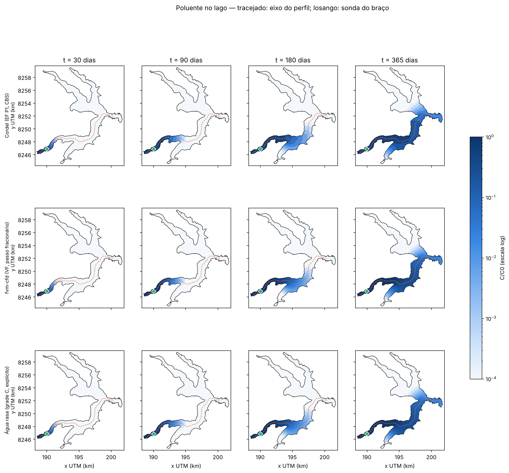
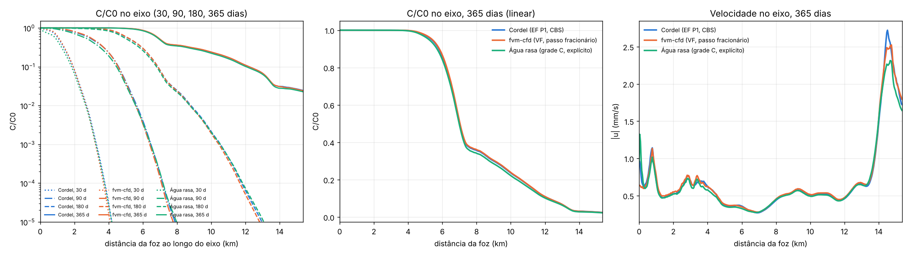
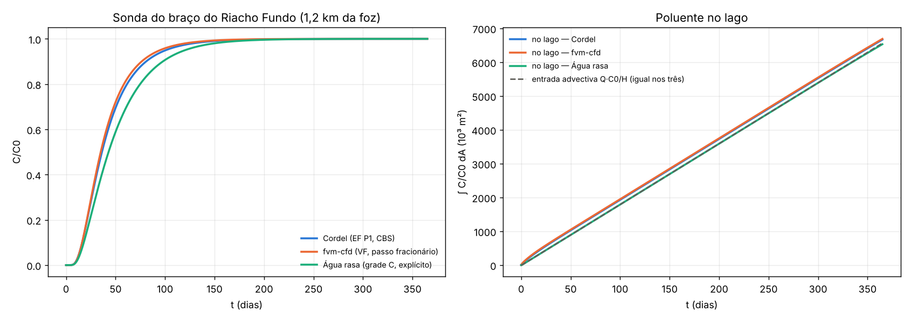
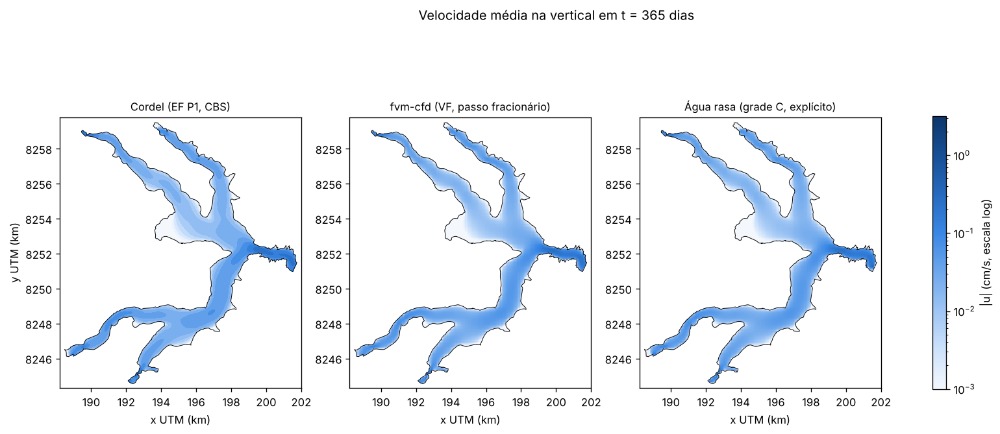
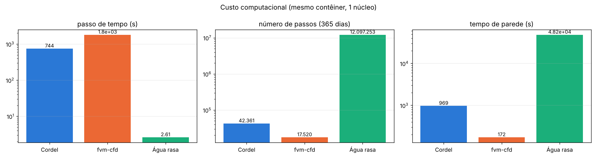

# Lago Paranoá em três códigos de CFD — comparação de 1 ano (ilustrativo)

> Cópia do relatório mantido no Cordel (`resultados/comparacao_paranoa_365d/`), onde está o script que gera as figuras.

O caso `paranoa` do Cordel, com o poluente lançado pelo Riacho Fundo no Lago Paranoá,
resolvido por três códigos por **365 dias**. As condições são as mesmas da
[comparação de 7 dias](https://github.com/lucianonoleto79/cordel/tree/main/resultados/comparacao_paranoa) do Cordel: mesmo contorno, vazões, H = 12 m,
ν = κ = 0,1 m²/s e malha de 80 m. Veja lá a descrição dos códigos e do caso.

**Os parâmetros são ilustrativos e não calibrados.** O modelo não tem vento, Coriolis,
atrito de fundo, batimetria nem estratificação. A concordância entre os códigos mostra
que os três métodos resolvem as mesmas equações de forma consistente; não diz nada
sobre o lago real.

| Código | Rodada | Comando |
|---|---|---|
| Cordel (EF P1, CBS) | [`resultados/paranoa_365d/`](https://github.com/lucianonoleto79/cordel/tree/main/resultados/paranoa_365d) (Cordel) | `python cordel2008v4.py paranoa --tmax 31536000 --saida paranoa_365d --op dias=30,90,180,365` |
| fvm-cfd (VF, passo fracionário) | `fvm-cfd/results/paranoa_365d_h80/` | `python python/paranoa.py --dias 365` |
| Água rasa (grade C, explícito) | `paranoa_agua_rasa/resultados/caso_cordel_365d/` | `python3 simulacao_paranoa.py --caso cordel --dias 365 --dx 80 --parar-apos 1.75` e depois `--continuar` até terminar (8 trechos) |

## Resultados em 365 dias

| em t = 365 dias | Cordel | fvm-cfd | Água rasa |
|---|---|---|---|
| C/C0 média no lago | 0,175 | 0,176 | 0,172 |
| C/C0 na sonda do braço do Riacho Fundo | 1,00 | 1,00 | 1,00 |
| C/C0 na sonda do Braço Sul | 0,217 | 0,220 | 0,213 |
| C/C0 na sonda do corpo central | 0,128 | 0,128 | 0,118 |
| C/C0 na sonda da barragem | 0,0239 | 0,0236 | 0,0222 |
| C/C0 na sonda do Braço Norte | 3×10⁻⁷ | 2×10⁻⁷ | 3×10⁻⁷ |
| área com C/C0 ≥ 1% (km²) | 17,9 | 17,8 | 17,9 |
| saiu pela barragem (% da entrada advectiva) | 0,48 | 0,46 | 0,46 |
| sonda do braço chega a C/C0 = 0,5 (dias) | 36 | 35 | 43 |
| sonda do braço chega a C/C0 = 0,9 (dias) | 81 | 76 | 98 |

Tabela completa em [`tabelas.md`](tabelas.md); números com mais casas em
[`metricas.json`](metricas.json).

**1. Em um ano, os três códigos dão praticamente o mesmo lago.** O poluente toma o braço
do Riacho Fundo (C/C0 ≈ 1 até ~5 km da foz), o Braço Sul e o corpo central e chega à
barragem com C/C0 ≈ 0,02. O Braço Norte fica limpo: nada entra lá, porque a corrente vai
dos afluentes para a barragem e o Braço Norte só recebe água limpa do Bananal e do Torto.
A concentração média difere 2% entre os códigos e as sondas, até ~8% (corpo central na
água rasa). Os perfis ao longo do eixo foz–barragem quase se sobrepõem.

**2. A diferença de massa vista em 7 dias quase desaparece.** Em 7 dias, a entrada por
difusão na foz (C = 1 imposto) acrescentava 65–82% ao Cordel e ao fvm-cfd. Em um ano essa
parcela cresce bem menos que a advectiva: a massa no lago passa a ficar só ~2% acima da
entrada advectiva no Cordel e no fvm-cfd (6,67 e 6,69 × 10⁶ m², contra
6,56 × 10⁶ m²); na água rasa, a massa no lago mais a que saiu é igual à entrada advectiva. A difusão domina
só enquanto o gradiente junto à foz é forte, no início.

**3. A frente da pluma chega mais tarde na água rasa.** Na sonda do braço, a 1,2 km da foz,
a água rasa leva 43 dias para chegar a C/C0 = 0,5, contra 35–36 nos outros dois. Duas
causas prováveis, **não verificadas separadamente**:
- na água rasa o poluente entra só por advecção, sem a parcela difusiva da foz;
- a fonte mistura a carga numa célula de 80 m, e o esquema *upwind* tem difusão numérica.

Depois de ~150 dias as três séries se juntam.

**4. O lago está longe do regime permanente.** Só ~0,5% do poluente que entrou saiu pela
barragem, e a concentração média ainda cresce linearmente. O tempo de residência V/Q é de
~620 dias, então um ano é pouco mais de meio tempo de residência.

## Desempenho

| | Cordel | fvm-cfd | Água rasa |
|---|---|---|---|
| Δt (s) | 744 | 1 800 | 2,6 |
| passos em 365 dias | 42 361 | 17 520 | 12 097 253 |
| tempo de parede | 16 min | 2 min 52 s | 13,4 h (8 trechos de 1h45 com checkpoint) |
| ms por passo | 23 | 9,8 | 4,0 |
| erro na conservação do poluente | não fechado (ver item 2) | 1×10⁻¹⁶ | 3×10⁻¹⁰ |

O padrão de 7 dias se repete. A água rasa tem o passo mais barato, mas o Δt limitado
pelas ondas de gravidade faz dela ~50 vezes mais lenta que o Cordel e ~280 vezes mais
lenta que o fvm-cfd. Como a rodada passou do limite de ~2 h das tarefas em segundo plano,
foi dividida em trechos com `--parar-apos` e `--continuar`. A retomada reproduz bit a bit
uma rodada direta, conferido num teste de 2 dias. As rodadas são únicas, no mesmo
contêiner, e as três correram em paralelo no começo (4 núcleos): tome os tempos como ordem
de grandeza.

## Arquivos

| Arquivo | Conteúdo |
|---|---|
| `comparacao_mapas.png` | C/C0 no lago em 30, 90, 180 e 365 dias, três códigos |
| `comparacao_perfil.png` | C/C0 e velocidade ao longo do eixo foz–barragem (caminho mínimo pelo meio do canal) |
| `comparacao_series.png` | C/C0 na sonda do braço e poluente no lago × entrada advectiva |
| `comparacao_velocidade.png` | velocidade em 365 dias |
| `comparacao_desempenho.png` | Δt, passos e tempo de parede |
| `tabelas.md`, `metricas.json` | métricas |

Gerados por `python post/comparar_paranoa.py --dias 365 --mapas 30,90,180,365 --log-cordel
resultados/paranoa_365d/resultados/paranoa_365d.log`, com os três repositórios lado a lado.
Os campos (`.npz`) não são versionados.

Contorno do lago: © OpenStreetMap contributors, ODbL.
